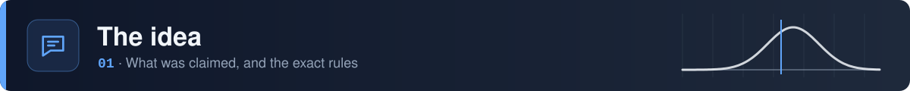
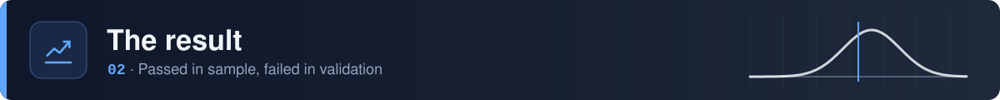
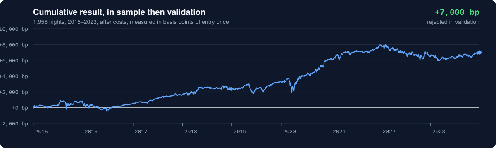
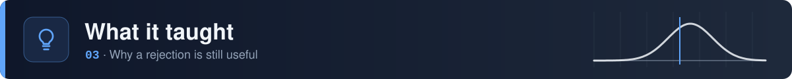
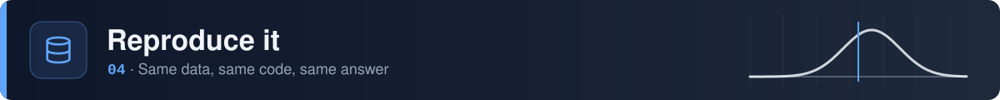

<picture>
  <source media="(prefers-color-scheme: dark)" srcset="./assets/banner-dark.svg" />
  <source media="(prefers-color-scheme: light)" srcset="./assets/banner-light.svg" />
  
</picture>

<br>

<div align="center">
  
  
  
  
  
</div>

<br>

One hypothesis from [the NQ Lab book](https://github.com/nqedgelab/nq-research), tested on its own terms: rules fixed before the test, costs included, and a verdict whichever way it went.

> [!IMPORTANT]
> **Rejected in validation.** It made +5.20 bp a night in sample (2015–2021), then lost 2.14 bp a night in 2022–2023. This is the first idea in the book to pass in sample, and the first to show why that isn't enough. The holdout years were never used.

<br>

<picture>
  <source media="(prefers-color-scheme: dark)" srcset="./assets/section-claim-dark.svg" />
  <source media="(prefers-color-scheme: light)" srcset="./assets/section-claim-light.svg" />
  
</picture>

**Claim.** Holding NQ long from the 16:00 ET close to the 09:30 ET open has positive expectancy after costs, and earns more than the regular-hours leg of the same days.

The idea comes from published research: Cliff, Cooper and Gulen (2008) and Lou, Polk and Skouras (*Journal of Financial Economics*, 2019) found that most US equity gains came between the close and the open.

<div align="center">

| Rule | Setting |
|:---|:---|
| Entry | Long at the close of the 15:59 bar |
| Exit | Open of the 09:30 bar of the next session. No stop, no target. |
| Skipped nights | Missing bars, early closes, suspect sessions, roll weeks, or a next session more than 4 days later |
| Weekends | Friday to Monday counts, reported separately |
| Costs | 0.25 pt commission, 1 tick slippage in and 1 out: 0.75 pt a round trip |
| Benchmark | The next session's regular hours, 09:30 to 16:00, same costs |

</div>

Results are in **basis points of the entry price**, as in H-002, since there's no stop to define R.

The full write-up, including the case against the idea, is in [`hypothesis.md`](hypothesis.md). It was committed before any test, and that commit is the first one in this repo's history.

<br>

<picture>
  <source media="(prefers-color-scheme: dark)" srcset="./assets/section-result-dark.svg" />
  <source media="(prefers-color-scheme: light)" srcset="./assets/section-result-light.svg" />
  
</picture>

<picture>
  <source media="(prefers-color-scheme: dark)" srcset="./assets/equity-dark.svg" />
  <source media="(prefers-color-scheme: light)" srcset="./assets/equity-light.svg" />
  
</picture>

<div align="center">

| | Nights | Win rate | Expectancy | 95% CI | Without 10 best | Regular hours |
|:---|:---:|:---:|:---:|:---:|:---:|:---:|
| In sample, 2015–2021 | 1,523 | 57.3% | **+5.20 bp** | +1.37 to +8.97 | +3.04 bp | +2.75 bp |
| Validation, 2022–2023 | 433 | 48.7% | **−2.14 bp** | −10.42 to +6.04 | −8.38 bp | +2.95 bp |

</div>

Steps 1 and 2 passed in sample. Step 3 needed validation expectancy above zero, and it failed. Full breakdowns for both periods are in [`results.md`](results.md).

<br>

<picture>
  <source media="(prefers-color-scheme: dark)" srcset="./assets/section-lessons-dark.svg" />
  <source media="(prefers-color-scheme: light)" srcset="./assets/section-lessons-light.svg" />
  
</picture>

- **Passing in sample isn't an edge.** The in-sample CI was entirely above zero, and the idea still failed on new data. This is the reason the book holds periods back.
- **It wasn't only the 2022 bear market.** In 2023, a strong up year, overnight made +2.17 bp a night while regular hours made +11.58 bp. The gains came in the day session, which is the opposite of the claim.
- **The best-looking slices failed hardest.** High-volatility nights went from +13.64 bp in sample to −6.47 bp in validation. Up-day entries went from +7.79 bp to −7.27 bp. Adding them as filters after seeing the first table would have made it worse.
- **A benchmark can be too easy.** On NQ, "overnight" is 17.5 hours of trading against 6.5 for regular hours, so pure drift helps the overnight leg. Future benchmarks should compare like with like.
- **The in-sample pass was most likely drift plus 2020.** Before 2020, the in-sample result already had a CI including zero.

<br>

<picture>
  <source media="(prefers-color-scheme: dark)" srcset="./assets/section-data-dark.svg" />
  <source media="(prefers-color-scheme: light)" srcset="./assets/section-data-light.svg" />
  
</picture>

```bash
pip install -r requirements.txt       # installs nqlab v0.1.0 from the book
python -m pytest                      # 10 tests, one per trading rule
python backtest/h003.py in_sample     # needs NQ_DATA_DIR in a .env file
python backtest/h003.py validation
```

Market data is licensed and isn't in the repo, and neither are the trade lists derived from it. `nqlab` is pinned to a tagged version, so later changes to the shared loader can't quietly change this result.

<details>
<summary><b>What's in the repo</b></summary>
<br>

```
nq-h003-overnight-drift/
├── hypothesis.md       the claim, rules and rejection criteria, written first
├── results.md          full results and breakdowns, in sample and validation
├── backtest/
│   ├── h003.py         the backtest
│   └── test_h003.py    one test per trading rule
└── assets/             README artwork and the script that draws it
```

</details>

<br>

<p align="center">
  <sub>Part of <a href="https://github.com/nqedgelab/nq-research">the NQ Lab book</a> · paper traded · not financial advice</sub>
</p>


